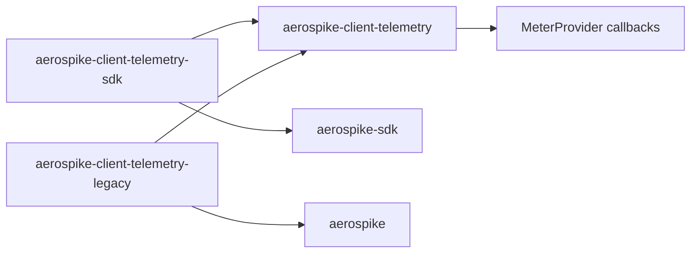
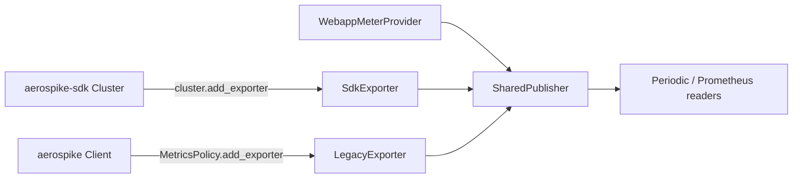

# Plan: legacy `aerospike` client support

Status: planned. Tracking: OM-373.

This exporter is built for the Python SDK (`aerospike-sdk`). This plan covers
using the same exporter with the legacy Python client (`aerospike`,
[aerospike-client-python](https://github.com/aerospike/aerospike-client-python)),
on branch `CLIENT-OM-381` at commit `d7fdf5f2c7483b216e494653a5c303665f44d157`.

## Summary

The exporter implementation is shared. Both clients hand `export(snapshot)` an
object whose `snapshot.to_canonical_dict()` returns the document described in
[reference.md](reference.md). Customers install one client wheel. That wheel
depends on the shared wheel, which does not install either client. The work is
that split, documentation of what the legacy client does not record, and tests.



At runtime the client wheel is only the registration surface. The shared wheel
owns the registry and the callbacks:



## Legacy client contract

| Item | Legacy client (`CLIENT-OM-381`) | SDK |
| --- | --- | --- |
| Registration | `MetricsPolicy(exporter="custom")`, then `policy.add_exporter(x)`, then `client.enable_metrics(policy)` | `cluster.add_exporter(x)`, then `enable_metrics(MetricsPolicy(...))` |
| `export` | Plain `def` only; async is rejected with `TypeError` | Sync or async, depending on the cluster |
| Caller thread | Daemon thread `aerospike-metrics-export` | SDK metrics task |
| Cadence | `export_interval` seconds (default 30); separate from `interval`, which counts tend iterations | `MetricsPolicy` interval |
| `client_type` | `python` | `python-sdk` |
| Failures | Isolated per exporter, suspended after 3 in a row, retried after 60 s | Same |
| `nodes_departed` | Kept until every exporter attempted in a cycle returns | Same |
| `close()` | Never called by the client | Never called by the client |

Use `OtelExporter` (sync) with the legacy client. `AsyncOtelExporter` is SDK only.

The distinct `client_type` puts a legacy client and an SDK client in one
process under different registry keys, so one provider and one exporter can
serve both.

### Latency buckets

The legacy bounds match the exporter's bucket math (base `2**latency_shift`,
first bound 1, last bucket `+Inf`):

| `latency_shift` | Legacy columns | Exporter `le` |
| --- | --- | --- |
| 1 | `<=1ms >1ms >2ms >4ms ...` | `1, 2, 4, ..., +Inf` |
| 3 | `<=1ms >1ms >8ms >64ms >512ms` | `1, 8, 64, 512, +Inf` |

### Tiers

The legacy client sets `operational_metrics_enabled` to `metrics_enabled` and
`usage_metrics_enabled` to `False`. Operational series are published.
`aerospike_client_feature_*` is not.

## Decisions

- **Packaging:** three wheels from this repo, described under [Wheels](#wheels).
  There is no `[legacy]` extra and no client dependency on the shared wheel.
- **Python floor:** stays `>=3.11` on all three wheels.
- **Unrecorded fields:** the legacy snapshot keeps them present and `0`, and the
  exporter publishes them. This is documented, not changed.

## Wheels

The package version is `0.0.1`, so replacing the single
`aerospike-client-telemetry-exporter` distribution is acceptable. One `VERSION`
file is copied into each build. A client wheel depends on
`aerospike-client-telemetry` at that same version.

| Wheel | Import root | Depends on | What it contains |
| --- | --- | --- | --- |
| `aerospike-client-telemetry` | `aerospike_client_telemetry` | Neither client. OpenTelemetry is imported lazily. | Catalog, registry, `to_canonical_dict()` publish path, observable callbacks, recording translation |
| `aerospike-client-telemetry-sdk` | `aerospike_client_telemetry_sdk` | Shared wheel and `aerospike-sdk>=1.0.0` | Sync and async OTel exporters. Sync and async recording exporters. Registered with `cluster.add_exporter`, then `enable_metrics`. |
| `aerospike-client-telemetry-legacy` | `aerospike_client_telemetry_legacy` | Shared wheel and `aerospike` at the first release that ships `MetricsPolicy.add_exporter` | Sync OTel exporter and sync recording exporter. Registered with `MetricsPolicy(exporter="custom")`, `add_exporter`, then `enable_metrics`. |

The legacy dependency is branch `CLIENT-OM-381` at `d7fdf5f2`. That branch's
`VERSION` is `19.3.1` until the release that ships `add_exporter`.

Each client wheel has an `[otel]` extra with `opentelemetry-*>=1.27.0`. A
recording-only install does not pull OpenTelemetry. The client classes call
the shared publisher. They do not copy the catalog or the callback loop.

```bash
pip install "aerospike-client-telemetry-sdk[otel]"
pip install "aerospike-client-telemetry-legacy[otel]"
```

```python
from aerospike_client_telemetry_sdk.otel import OtelExporter, AsyncOtelExporter
from aerospike_client_telemetry_legacy.otel import OtelExporter as LegacyOtelExporter
```

Installing both client wheels in one environment is valid. `client_type`
stays `python-sdk` and `python`, so the shared registry keeps their documents
apart.

Source layout:

- `packages/telemetry/`
- `packages/telemetry-sdk/`
- `packages/telemetry-legacy/`

The root [pyproject.toml](../pyproject.toml) stops being the installable
project. Tests stay at the repo root and install the wheel they exercise.

### Fields the legacy client publishes as 0

| Snapshot field | Reason |
| --- | --- |
| `namespace.timeouts`, `cluster.command_timeout_client` | Only a combined `timeout_count` exists; it is not exported |
| `namespace.record_too_big`, `namespace.device_overload` | Not recorded |
| `node.connections.open_failure` and the TLS and auth fields | Not recorded |
| `cluster.recover_queue.size` | Not recorded |

Other differences:

- `cluster.latency` is empty, so `aerospike_client_latency_bucket` is absent.
- Namespace `conn` is pool-acquisition time on the document. It is not exported.
  Socket-open latency is `aerospike_client_node_conn_latency_bucket`, from
  `nodes[].latency.conn`.
- Async pool counts are not in the document.

## Work items

1. **Shared wheel.** Move the catalog, registry, publish path, and recording
   translation into `packages/telemetry/`. Drop `aerospike-sdk` from its
   dependencies. Keep `requires-python` at `>=3.11`.
2. **SDK wheel.** Add `packages/telemetry-sdk/` with sync and async OTel and
   recording exporters, an `[otel]` extra, and a dependency on
   `aerospike-sdk>=1.0.0` plus the shared wheel at the same version.
3. **Legacy wheel.** Add `packages/telemetry-legacy/` with sync exporters only,
   an `[otel]` extra, and a dependency on `aerospike` at the first release with
   `MetricsPolicy.add_exporter`.
4. **README.** In [README.md](../README.md), replace the single install line
   with the two client wheels and show both registration paths:

   ```python
   from aerospike_helpers.metrics import MetricsPolicy
   from aerospike_client_telemetry_legacy.otel import OtelExporter

   policy = MetricsPolicy(exporter="custom", export_interval=30, labels={"env": "prod"})
   policy.add_exporter(OtelExporter(provider))
   client.enable_metrics(policy)
   ```

5. **metrics.md.** In [metrics.md](metrics.md), add a section "Legacy client
   (`client_type=python`)" with the zero-field table and the other differences
   above.
6. **reference.md.** In [reference.md](reference.md), list the `client_type`
   values (`python-sdk`, `python`), and note that a 0 may mean "not recorded by
   this client" and that per-client coverage is in `metrics.md`.
7. **Unit test.** Add `tests/unit/otel/test_legacy_client.py`. It needs no live
   client and uses a static fixture copied from the legacy `to_canonical_dict()`
   shape. Assert:
   - Cluster, node, and namespace series appear.
   - `le` buckets are correct for shift 1 and shift 3.
   - `aerospike_client_feature_*` and cluster latency series are absent.
   - A legacy snapshot and an SDK snapshot on one exporter stay separate by
     `client_type`.
   - Webapp instruments on the same provider still collect.
8. **Integration test.** Add `tests/integration/otel/test_legacy_client.py`. It
   skips through `pytest.importorskip("aerospike")`, and also when
   `MetricsPolicy` has no `add_exporter`. Using the existing Aerospike
   testcontainer fixture, it:
   - Registers `OtelExporter(provider)` with `export_interval=1`.
   - Runs `put` and `get`.
   - Asserts that `aerospike_client_nodes_active` and the namespace read
     latency appear with `client_type="python"`, next to a webapp counter on the
     same provider.
9. **CI.** In [build-test.yml](../.github/workflows/build-test.yml), build all
   three wheels. SDK tests install the SDK wheel. The legacy job pins
   `LEGACY_REF: d7fdf5f2c7483b216e494653a5c303665f44d157`, installs the legacy
   wheel, and installs
   `aerospike @ git+https://github.com/aerospike/aerospike-client-python@${LEGACY_REF}`
   with submodules. This builds the C client and needs `libssl-dev`. The job
   runs the two legacy test files.
10. **Verify and commit.** Run the unit and integration suites; install the
   legacy client from a local checkout to run the legacy integration test for
   real. Make one conventional commit per item, then push.

## Forward compatibility

The two clients do not share a snapshot class. `export()` only calls
`snapshot.to_canonical_dict()` and walks the keys this package's catalog
knows. A future SDK document that is a superset does not break a legacy
client that never adopts the new class.

| SDK change | Legacy document | Result |
| --- | --- | --- |
| New key, exporter catalog not updated yet | Key absent | Ignored. No new series until the exporter is released. |
| New key, exporter catalog updated | Key absent | Series is omitted for the legacy client and published for the SDK. No error. |
| Extra keys the catalog does not name | Present or absent | Ignored. |
| Rename, move, or change the type of an existing key | Old path | That series disappears for the legacy client, or is misread if the old path still exists with a new meaning. |
| Reuse a key the legacy client already writes as `0` | Present `0` | Published as `0`. A real SDK value and a legacy zero share one series name. |

The rule that keeps a superset safe: a missing key omits the series, and the
exporter does not require the SDK snapshot type. A breaking change is a
changed path or a changed meaning of a path the legacy document still fills.

New series stay additive. `client_type` keeps the two clients on separate
registry keys, so a new SDK field does not overwrite a legacy document.

## Out of scope

- Changing the legacy snapshot to omit unrecorded fields.
- Splitting the legacy `timeout_count` into client and server timeouts.
- Async export for the legacy client.
- Lowering the Python floor below 3.11.
- A `[legacy]` extra on one wheel that also installs `aerospike-sdk`.
- Copying the catalog, registry, or callback loop into a client wheel.
- Replaying intermediate gauge values through the observable callback. The
  meter provider keeps one point per series per collect.
