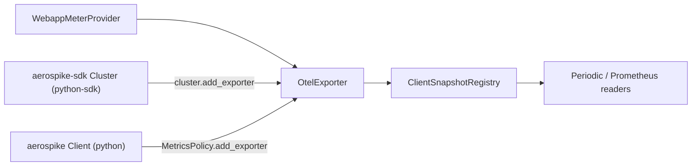

# Plan: legacy `aerospike` client support

Status: planned. Tracking: OM-373.

This exporter is built for the Python SDK (`aerospike-sdk`). This plan covers
using the same exporter with the legacy Python client (`aerospike`,
[aerospike-client-python](https://github.com/aerospike/aerospike-client-python)),
on branch `CLIENT-OM-381` at commit `d7fdf5f2c7483b216e494653a5c303665f44d157`.

## Summary

The exporter works with the legacy client without any change to its logic.
Both clients hand `export(snapshot)` an object whose
`snapshot.to_canonical_dict()` returns the document described in
[reference.md](reference.md). The work is packaging, documentation of what the
legacy client does not record, and tests.



## Legacy client contract

| Item | Legacy client (`CLIENT-OM-381`) | SDK |
| --- | --- | --- |
| Registration | `MetricsPolicy(exporter="custom")`, then `policy.add_exporter(x)`, then `client.enable_metrics(policy)` | `cluster.add_exporter(x)`, then `enable_metrics(MetricsPolicy(...))` |
| `export` | Plain `def` only; async is rejected with `TypeError` | Sync or async, depending on the cluster |
| Caller thread | Daemon thread `aerospike-metrics-export` | SDK metrics task |
| Cadence | `export_interval` seconds (default 30); separate from `interval`, which counts tend iterations | `MetricsPolicy` interval |
| `client_type` | `python` | `python-sdk` |
| Failures | Isolated per exporter, suspended after 3 in a row, retried after 60 s | Same |
| `nodes_departed` | Kept until every exporter attempted in a cycle returns | Same |
| `close()` | Never called by the client | Never called by the client |

Use `OtelExporter` (sync) with the legacy client. `AsyncOtelExporter` is SDK only.

The distinct `client_type` puts a legacy client and an SDK client in one
process under different registry keys, so one provider and one exporter can
serve both.

### Latency buckets

The legacy bounds match the exporter's bucket math (base `2**latency_shift`,
first bound 1, last bucket `+Inf`):

| `latency_shift` | Legacy columns | Exporter `le` |
| --- | --- | --- |
| 1 | `<=1ms >1ms >2ms >4ms ...` | `1, 2, 4, ..., +Inf` |
| 3 | `<=1ms >1ms >8ms >64ms >512ms` | `1, 8, 64, 512, +Inf` |

### Tiers

The legacy client sets `operational_metrics_enabled` to `metrics_enabled` and
`usage_metrics_enabled` to `False`. Operational series are published.
`aerospike.client.feature.*` is not.

## Decisions

- **Packaging:** `aerospike-sdk` stays a core dependency. A new `[legacy]` extra
  installs the legacy client.
- **Python floor:** stays `>=3.11`, because `aerospike-sdk` requires 3.11 and is
  in core. Legacy-client users need Python 3.11 or later to use this exporter.
- **Unrecorded fields:** the legacy snapshot keeps them present and `0`, and the
  exporter publishes them. This is documented, not changed.

### Fields the legacy client publishes as 0

| Snapshot field | Reason |
| --- | --- |
| `namespace.client_timeouts`, `namespace.server_timeouts` | Only a combined `timeout_count` exists; it is not exported |
| `namespace.record_too_big`, `namespace.device_overload` | Not recorded |
| `validation_open_failure`, `validation_tls_handshake_failure`, `validation_auth_failure` | Not recorded |
| `node.connection_open_failure`, `node.connection_tls_handshake_failure`, `node.connection_auth_failure` | Not recorded |
| `recover_queue_size`, `delay_queue_timeout_count`, `batch_partial_failure` | Not recorded |

Other differences:

- `cluster_latencies` is empty, so there are no cluster latency series.
- Node `conn` latency is the sum of each namespace's `conn_latency`.
- Async pool counts are not in the document.

## Work items

1. **Packaging.** In [pyproject.toml](../pyproject.toml), add a `legacy` entry
   under `[project.optional-dependencies]`, pinned to the first `aerospike`
   release that ships `MetricsPolicy.add_exporter`. Confirm the version before
   release; the branch `VERSION` is `19.3.1`. Core and `requires-python` stay
   unchanged.
2. **Docstrings.** In
   [otel/exporter.py](../aerospike_client_telemetry/otel/exporter.py) and
   [recording/exporter.py](../aerospike_client_telemetry/recording/exporter.py),
   name both hosts of the sync exporters: `aerospike_sdk.sync.Cluster` and the
   legacy `aerospike.Client` through `MetricsPolicy.add_exporter`. State that
   the async exporters are SDK only.
3. **README.** In [README.md](../README.md), add a `[legacy]` row to the
   dependency table, the install line, and a registration snippet:

   ```bash
   pip install "aerospike-client-telemetry-exporter[legacy,otel]"
   ```

   ```python
   from aerospike_helpers.metrics import MetricsPolicy
   from aerospike_client_telemetry.otel import OtelExporter

   policy = MetricsPolicy(exporter="custom", export_interval=30, labels={"env": "prod"})
   policy.add_exporter(OtelExporter(provider))
   client.enable_metrics(policy)
   ```

4. **metrics.md.** In [metrics.md](metrics.md), add a section "Legacy client
   (`client_type=python`)" with the zero-field table and the other differences
   above.
5. **reference.md.** In [reference.md](reference.md), list the `client_type`
   values (`python-sdk`, `python`), and note that a 0 may mean "not recorded by
   this client" and that per-client coverage is in `metrics.md`.
6. **Unit test.** Add `tests/unit/otel/test_legacy_client.py`. It needs no live
   client and uses a static fixture copied from the legacy `to_canonical_dict()`
   shape. Assert:
   - Cluster, node, and namespace series appear.
   - `le` buckets are correct for shift 1 and shift 3.
   - `aerospike.client.feature.*` and cluster latency series are absent.
   - A legacy snapshot and an SDK snapshot on one exporter stay separate by
     `client_type`.
   - Webapp instruments on the same provider still collect.
7. **Integration test.** Add `tests/integration/otel/test_legacy_client.py`. It
   skips through `pytest.importorskip("aerospike")`, and also when
   `MetricsPolicy` has no `add_exporter`. Using the existing Aerospike
   testcontainer fixture, it:
   - Registers `OtelExporter(provider)` with `export_interval=1`.
   - Runs `put` and `get`.
   - Asserts that `aerospike.client.cluster.total_nodes` and the namespace read
     latency appear with `client_type="python"`, next to a webapp counter on the
     same provider.
8. **CI.** In [build-test.yml](../.github/workflows/build-test.yml), add an
   `integration-legacy` job. It pins
   `LEGACY_REF: d7fdf5f2c7483b216e494653a5c303665f44d157` and installs
   `aerospike @ git+https://github.com/aerospike/aerospike-client-python@${LEGACY_REF}`
   with submodules. This builds the C client and needs `libssl-dev`. The job
   runs the two legacy test files.
9. **Verify and commit.** Run the unit and integration suites; install the
   legacy client from a local checkout to run the legacy integration test for
   real. Make one conventional commit per item, then push.

## Forward compatibility

The two clients do not share a snapshot class. `export()` only calls
`snapshot.to_canonical_dict()` and walks the keys this package's catalog
knows. A future SDK document that is a superset does not break a legacy
client that never adopts the new class.

| SDK change | Legacy document | Result |
| --- | --- | --- |
| New key, exporter catalog not updated yet | Key absent | Ignored. No new series until the exporter is released. |
| New key, exporter catalog updated | Key absent | Series is omitted for the legacy client and published for the SDK. No error. |
| Extra keys the catalog does not name | Present or absent | Ignored. |
| Rename, move, or change the type of an existing key | Old path | That series disappears for the legacy client, or is misread if the old path still exists with a new meaning. |
| Reuse a key the legacy client already writes as `0` | Present `0` | Published as `0`. A real SDK value and a legacy zero share one series name. |

The rule that keeps a superset safe: a missing key omits the series, and the
exporter does not require the SDK snapshot type. A breaking change is a
changed path or a changed meaning of a path the legacy document still fills.

New series stay additive. `client_type` keeps the two clients on separate
registry keys, so a new SDK field does not overwrite a legacy document.

## Out of scope

- Changing the legacy snapshot to omit unrecorded fields.
- Splitting the legacy `timeout_count` into client and server timeouts.
- Async export for the legacy client.
- Lowering the Python floor below 3.11.
